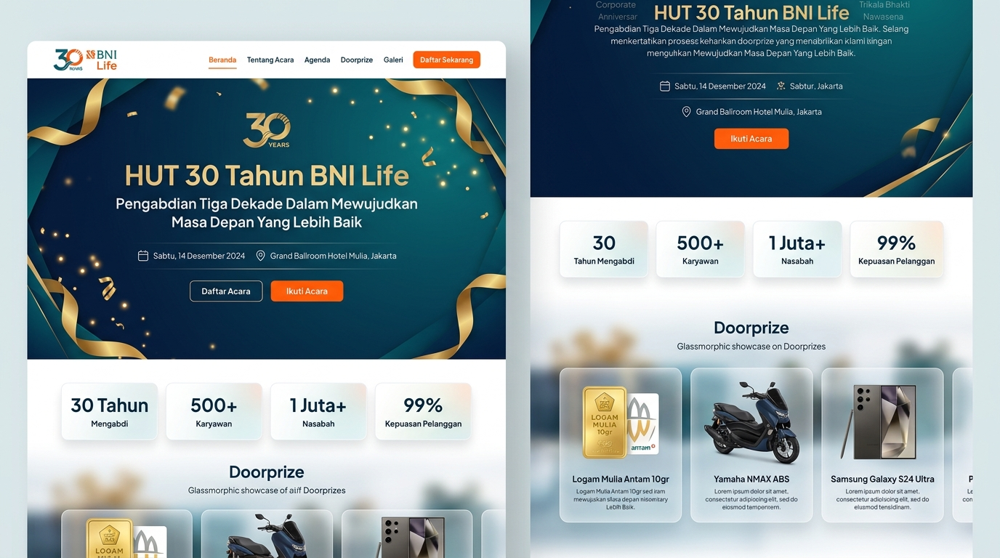
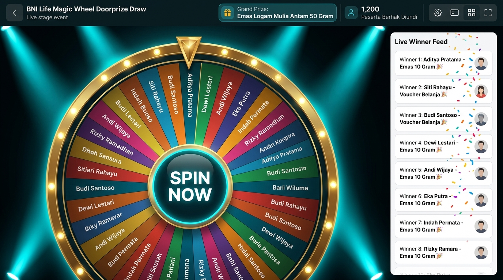
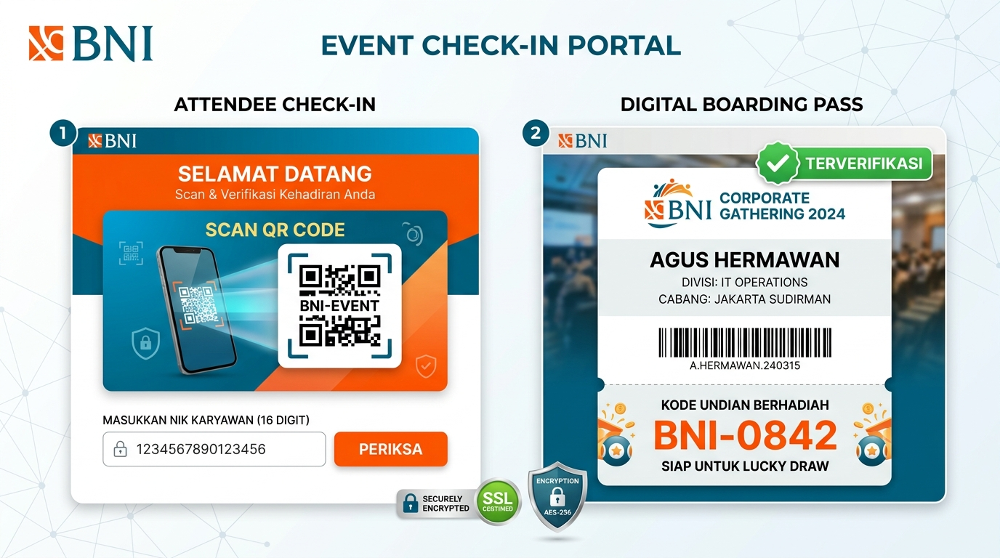
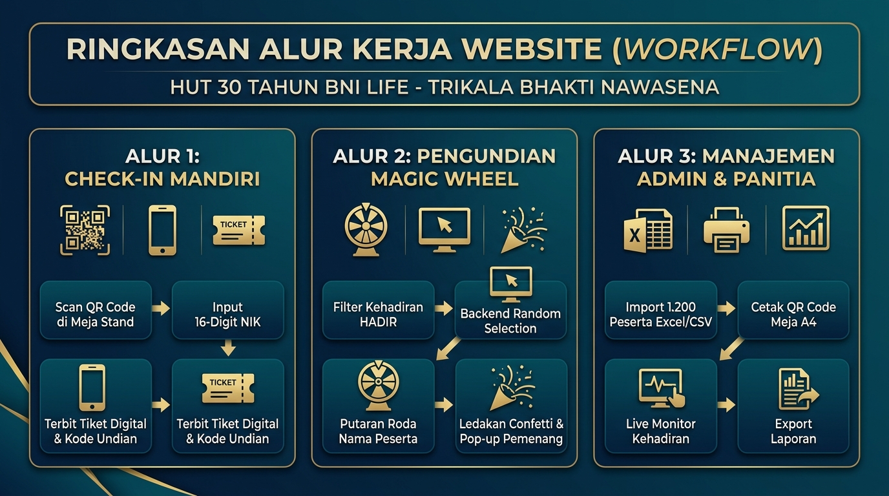
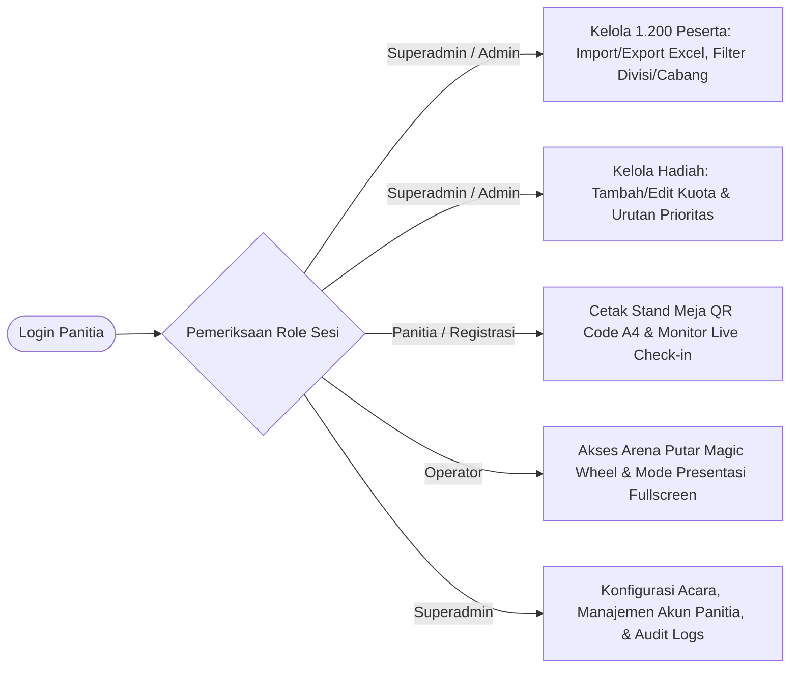

# Dokumentasi Mockup & Alur Sistem Website
## HUT 30 Tahun BNI Life — Trikala Bhakti Nawasena
*“Pengabdian Tiga Dekade Dalam Mewujudkan Masa Depan Yang Lebih Baik”*

Dokumen ini menyajikan visual mockup antarmuka pengguna (UI), arsitektur teknologi, serta alur kerja menyeluruh (*user flow & system flow*) dari website perayaan HUT ke-30 BNI Life.

---

## 1. Galeri Visual Mockup

### A. Mockup Halaman Utama (Landing Page)
Menampilkan desain modern dengan gradien *Deep Navy* (`#0B2240`), aksen pita emas perayaan (*Gold Ribbons*), logo resmi 30 Tahun BNI Life, statistik kehadiran peserta real-time, serta kartu *glassmorphism* daftar doorprize (Emas Antam, Motor Vario, iPhone 16 Pro Max, dsb.).



---

### B. Mockup Arena Undian Doorprize (Magic Wheel Stage)
Dirancang khusus untuk layar proyektor panggung utama auditorium dalam mode *dark-mode presentation*. Roda undian digital menampilkan **Nama Lengkap Peserta** secara langsung dari MySQL, dilengkapi lampu sorot panggung, indikator jarum emas, dan *Live Winner Feed* dengan animasi confetti.



---

### C. Mockup Alur Check-in & Tiket Digital (Attendee Check-in & Pass)
Sistem registrasi mandiri dua langkah:
1. **Langkah 1**: Scan QR Code di meja registrasi dan input 16-digit NIK karyawan.
2. **Langkah 2**: Verifikasi identitas dan penerbitan *Digital Boarding Pass* yang memuat nomor undian unik (misal: `BNI-0842`) sebagai tiket resmi pengundian di Magic Wheel.



---

### D. Infografis Ringkasan Alur Kerja Website (Workflow Infographic)
Visual diagram alur kerja komprehensif yang merangkum 3 pilar utama sistem: Check-in Mandiri, Pengundian Magic Wheel, dan Manajemen Admin & Panitia.



---

## 2. Diagram Alur Sistem (System Flowcharts)

### Alur 1: Check-in Mandiri Peserta (QR Code & NIK)

```mermaid
flowchart TD
    A([Peserta Tiba di Venue]) --> B[Scan QR Code di Stand Meja A4 / Buka URL Check-in]
    B --> C[Halaman Check-in: Input 16 Digit NIK Pegawai]
    C --> D{Validasi Format NIK & Rate Limiting}
    D -- Tidak Valid / >20x Gagal --> E[Tampilkan Pesan Error / Blokir Sementara]
    D -- Valid (16 Digit Angka) --> F[Kirim Request ke API validate-nik.php]
    F --> G{Cari NIK di Tabel participants}
    G -- Tidak Ditemukan --> H[Alert: NIK Tidak Terdaftar pada Database Undian]
    G -- Ditemukan --> I{Cek Status Kehadiran}
    I -- Sudah Hadir --> J[Tampilkan Tiket yang Sudah Pernah Di-generate]
    I -- Belum Hadir --> K[Tampilkan Modal Konfirmasi Identitas: Nama, Divisi, Cabang]
    K --> L[Peserta Klik 'Konfirmasi Kehadiran Saya']
    L --> M[API confirm-checkin.php: Transaksi Atomik Database]
    M --> N[Update status_kehadiran = 'HADIR' & waktu_checkin = NOW()]
    N --> O[Redirect ke Halaman check-in-success.php]
    O --> P([Terbit Tiket Digital: Nomor Undian Siap Masuk Magic Wheel])
```

---

### Alur 2: Pengundian Hadiah (Magic Wheel Doorprize Draw)

```mermaid
flowchart TD
    A([Operator Membuka Arena Magic Wheel]) --> B[Pilih Kategori Hadiah: Grand Prize / Utama / Favorit]
    B --> C[Sistem Memuat Peserta yang Memenuhi Syarat dari MySQL]
    Note1[Syarat: status_kehadiran = 'HADIR'<br>+ Belum Pernah Menang jika aturan one_win_only]
    C -. Memenuhi Syarat .-> Note1
    C --> D{Jumlah Peserta Layak > 0?}
    D -- Tidak Ada --> E[Peringatan: Belum ada peserta hadir yang berhak diundi]
    D -- Ada --> F[Operator Klik Tombol 'SPIN NOW']
    F --> G[Panggil Backend API draw-winner.php]
    G --> H[PHP Backend: random_int() dengan Row Locking FOR UPDATE]
    H --> I[Simpan Pemenang ke Tabel draw_results dengan status 'SAH']
    I --> J[Kirim Data Pemenang Terpilih ke Frontend Canvas Wheel]
    J --> K[Roda Berputar Visual Selama 7+ Detik]
    K --> L[Audio Synthesizer: Efek Suara Ratchet Ticks berputar]
    L --> M[Roda Melambat dan Berhenti Tepat pada Nama Pemenang]
    M --> N[Audio Fanfare Kemenangan Berbunyi + Ledakan Confetti]
    N --> O[Pop-up Modal Pemenang Berukuran Besar Tampil di Layar Panggung]
    O --> P([Daftar Pemenang Otomatis Masuk ke Ticker Sidebar & Halaman Publik])
```

---

### Alur 3: Manajemen Panitia & Administrator (RBAC Panel)



---

## 3. Struktur Tabel Database Relasional

Aplikasi menggunakan engine **MySQL InnoDB** yang menjamin transaksi *ACID compliant* dan penguncian baris (*row-level locking*):

| Nama Tabel | Deskripsi & Fungsi Utama |
|---|---|
| **`participants`** | Menyimpan data 1.200+ pegawai (NIK 16 digit, nomor undian unik `BNI-XXXX`, nama lengkap, divisi, cabang, status kehadiran, dan waktu check-in). |
| **`prizes`** | Menyimpan katalog doorprize, jumlah kuota pemenang per kategori, urutan undian, dan status aktif. |
| **`draw_results`** | Menyimpan riwayat undian sah, relasi pemenang (`participant_id`), hadiah (`prize_id`), ID sesi undian, dan timestamp. |
| **`admins`** | Menyimpan kredensial panitia dengan proteksi *BCRYPT password hash* dan pembagian hak akses (*Role-Based Access Control*). |
| **`audit_logs`** | Pencatatan otomatis riwayat keamanan dan aktivitas mutasi data panitia. |
| **`event_settings`** | Pengaturan dinamis konfigurasi judul acara, tema, lokasi, dan aturan menang (*one_win_only*). |

---

## 4. Keamanan & Performa Sistem

1. **Perlindungan NIK & Privasi**: Pada layar proyektor publik dan daftar pemenang, NIK dimasking (`3171********0001`) demi kepatuhan UU Pelindungan Data Pribadi (PDP).
2. **Pencegahan Double-Spin & Race Condition**: Pengundian menggunakan transaksi database atomik dengan klausa `FOR UPDATE` sehingga mustahil terjadi bentrok pengundian bersamaan.
3. **True Backend Randomness**: Pemenang dipilih oleh mesin backend kriptografis (`random_int()`), bukan diacak secara manipulatif di browser pengguna.
4. **Offline Audio & Visual Standalone**: Efek suara putaran roda dan *fanfare* dibuat menggunakan HTML5 Web Audio API sintetis dan confetti kanvas mandiri, berfungsi 100% tanpa bergantung pada file audio eksternal.
